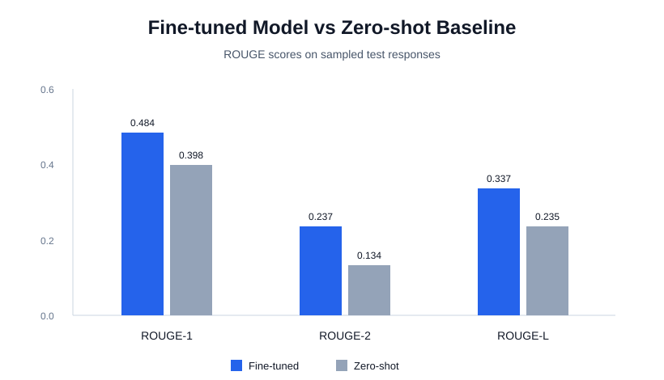
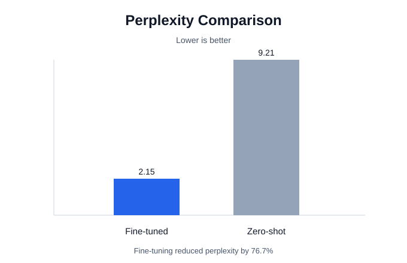
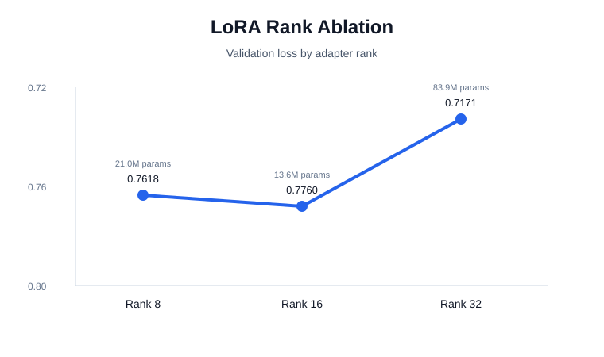

# Customer Support LLM Fine-Tuning

A portfolio project exploring parameter-efficient fine-tuning for customer support dialogue. The project fine-tunes `mistralai/Mistral-7B-Instruct-v0.3` with QLoRA on the Bitext customer support dataset, evaluates it against a zero-shot baseline, and wraps the resulting adapter in a small FastAPI/chat demo.

## What This Shows

- Dataset preparation for instruction-following customer support responses
- QLoRA fine-tuning with 4-bit NF4 quantization
- LoRA adapter configuration and training trade-offs
- Evaluation with ROUGE, BLEU, perplexity, per-intent analysis, and qualitative examples
- A lightweight inference API and browser chat interface

## Project Structure

```text
.
|-- PartB_LLM_Pro_clean.ipynb   # Cleaned training, evaluation, and analysis notebook
|-- Demo_Notebook.ipynb          # Colab demo flow for loading the adapter and serving the API
|-- api.py                       # FastAPI inference wrapper
|-- config.py                    # Central model/training/inference configuration
|-- chat_demo.html               # Simple browser chat UI
|-- tests.py                     # API/model sanity checks
|-- Dockerfile                   # Deployment container skeleton
|-- requirements.txt             # Python dependencies
|-- findings.md                  # Results, limitations, and interpretation
|-- results/                     # Suggested location for exported charts
```

## Model And Data

- Base model: `mistralai/Mistral-7B-Instruct-v0.3`
- Dataset: Bitext customer support dataset
- Fine-tuning method: QLoRA / LoRA adapters
- Quantization: 4-bit NF4 with double quantization
- LoRA rank: 16
- LoRA alpha: 32
- Max sequence length: 512 tokens
- Training steps: 750

## Results Summary

| Metric | Fine-tuned | Zero-shot | Change |
| --- | ---: | ---: | ---: |
| ROUGE-1 | 0.4844 | 0.3976 | +21.8% |
| ROUGE-2 | 0.2367 | 0.1337 | +77.0% |
| ROUGE-L | 0.3368 | 0.2347 | +43.5% |
| Perplexity | 2.15 | 9.21 | -76.7% |

## Result Visuals







See `findings.md` for interpretation, limitations, and suggested next steps.

## Run The API

Install dependencies:

```bash
pip install -r requirements.txt
```

Update `ADAPTER_PATH` in `config.py` to point to your local LoRA adapter, then run:

```bash
uvicorn api:app --host 0.0.0.0 --port 8000
```

Endpoints:

- `POST /chat` sends a customer message and returns a generated support response
- `GET /health` checks model status and basic request statistics

## Demo UI

Open `chat_demo.html` in a browser and connect it to the running API URL. For a Colab/ngrok workflow, use `Demo_Notebook.ipynb`.

## Notes

The trained adapter weights are not included in this repository. This keeps the portfolio repo lightweight and avoids redistributing model artifacts. To reproduce the project, run the cleaned notebook and save the adapter locally.
